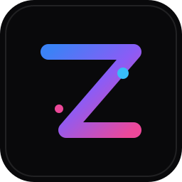

<div align="center">
  

# ZYR0 Studio

### Build websites & web apps through natural language conversations with agentic AI

[](./LICENSE)
[](./CHANGELOG.md)
[](https://nodejs.org)

[Documentation](docs/README.md) · [Changelog](CHANGELOG.md) · [License](LICENSE)

---

</div>

## Overview

**ZYR0 Studio** is an agentic AI-powered web development platform where you build, test, maintain, and deploy modern websites and web applications through natural language conversations.

Whether you need a static landing page, a component-driven React/Vue/Svelte application, or a full-stack database-backed application with serverless Edge Functions, ZYR0 Studio coordinates the process inside a secure, sandboxed environment.

**What you get:**
- **Multiple Runtimes** — Static (HTML/CSS/JS), Handlebars (templated sites), React, Preact, Svelte, Vue, Python (Pyodide), Lua (Wasmoon)
- **Sandboxed Agent** — Operates in a virtual file system with automatic per-message checkpoints — explore freely, rollback anytime
- **Dual AI Modes** — Chat (exploration, planning, Q&A) + Code (full multi-file implementation)
- **Multi-Provider AI Orchestration** — OpenRouter (200+ models), OpenAI (+ ChatGPT sign-in), Anthropic Claude, Google Gemini, Groq, HuggingFace, DeepSeek, MiniMax, Zhipu AI, SambaNova, Ollama, LM Studio, llama.cpp
- **Full In-Browser IDE** — Monaco code editor, live hot-reload preview, file explorer, multi-tab support, and interactive terminal
- **Deploy & Export Anywhere** — Export as clean ZIP archives, standalone `.oswt` templates, or full-history `.osws` backups
- **Self-Hosted Server Mode** — Multi-user workspaces, serverless QuickJS Edge Functions, SQLite per-deployment databases, secrets management, SEO controls, and automated Caddy custom domain routing

---

## 🚀 Quick Start

Get started in **3 steps**:

```bash
# 1. Clone repository
git clone https://github.com/ilyaskhan/zyr0-studio.git
cd zyr0-studio

# 2. Install dependencies
npm install

# 3. Start development server
npm run dev
```

**Start Building:**
1. Open [http://localhost:3000](http://localhost:3000)
2. Click **Settings** (gear icon) → Select your preferred AI provider (or connect local Ollama/LM Studio) → Enter API Key
3. Create a project and describe what you want to build!

---

## Key Features

### 💻 Development Environment
- **Monaco Editor** — Professional code editor with syntax highlighting, search/replace, and IntelliSense
- **Live Preview** — Instant hot-reloading as the AI generates and modifies files
- **File Explorer** — Full virtual file tree with right-click actions (create, rename, delete, download)
- **Multi-Tab Workspace** — Work on multiple source files concurrently

### 🧠 Agentic AI Architecture
- **Single-Tool Shell Paradigm** — Uses a virtual bash shell (`ls`, `cat`, `grep`, `find`, `mkdir`, `rm`, `sed -i`, `build`, `status`) to manipulate files safely
- **Automated Checkpoints** — Every turn creates a snapshot; easily roll back to any point in the conversation
- **Multi-Agent Coordination** — Intake, interview, planning, and task execution agents collaborate seamlessly
- **Skills System** — Inject custom workflow skills and domain guidelines into the agent prompt

### 🌐 Server Mode (Optional)
Run as a multi-user self-hosted platform:
- **Workspaces** — Isolated team environments with quotas and role management
- **SQLite Databases** — Per-project database with interactive SQL browser
- **Edge Functions** — Run serverless JavaScript functions powered by QuickJS WebAssembly
- **Scheduled Functions** — Execute cron-scheduled edge tasks
- **Custom Domains** — Automated SSL certificate provisioning via Caddy reverse proxy

---

## Tech Stack

- **Framework**: Next.js 16, React 19, TypeScript
- **Styling**: Tailwind CSS v4, Radix UI primitives, Lucide Icons
- **Editor**: Monaco Editor (`@monaco-editor/react`)
- **Execution Runtimes**: QuickJS WASM, esbuild-wasm, Handlebars, Pyodide, Wasmoon
- **Database & Auth**: SQLite (`better-sqlite3`), JWT (`jose`), `bcrypt`
- **State Management**: Zustand, TanStack React Query

---

## Privacy & Security

- **API Keys**: Stored purely in your browser `localStorage` and never sent to any central telemetry server
- **Local AI Support**: Fully functional with offline/local providers like Ollama, LM Studio, and llama.cpp for complete privacy
- **Sandbox Isolation**: Safe virtual file system execution preventing unauthorized system escapes

---

## Author & Maintainer

Created and maintained by **Ilyas Khan** (`ik7408008@gmail.com`).

Contributions, issues, and feature requests are welcome!

---

## License

This project is licensed under the MIT License - see the [LICENSE](LICENSE) file for details.
